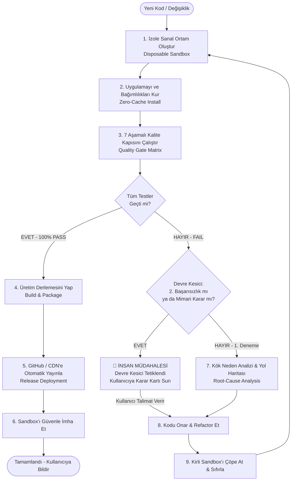

# 🛡️ Clean-Room Sandbox CI/CD & Human-in-the-Loop (HITL) Framework
### Otonom Geliştirme, Temiz Oda Doğrulama ve Sıfır Hata Sürüm Dağıtım Standardı

> **Sürüm:** 1.0.0  
> **Kullanım Kapsamı:** Masaüstü (Electron/Tauri/Qt), Arka Yüz (FastAPI/Node/Go), Yapay Zekâ & RAG Sistemleri, Mobil ve Web Uygulamaları.  
> **Temel İlke:** *"Yeni format atılmış tertemiz bir bilgisayarda çalışmayan hiçbir kod, kullanıcıya ulaştırılamaz."*

---

## 📌 1. Neden "Temiz Oda" (Clean-Room) Yaklaşımı?

Yazılım geliştirme ve test süreçlerinde karşılaşılan en yaygın 4 yapısal tuzak:
1. **Kirli Çevre Maskelemesi (Dirty Environment):** Geliştiricinin veya kullanıcının bilgisayarında önceden kalmış `settings.json`, eski Python paketleri veya `C:\Users\...` altındaki önbellekler, yeni yazılan kodun eksiklerini maskeler. Geliştiricide çalışan kod, son kullanıcıda çöker.
2. **Sessiz Veri Sızıntısı (Data & Model Leak):** Yapay zekâ kütüphaneleri (Hugging Face, PyTorch, ChromaDB) varsayılan olarak kullanıcının `C:\` sürücüsünü doldurur; kullanıcının seçtiği hedef sürücüye (örn. `F:\`) kurulmaz.
3. **Kullanıcıyı Kobay Yapma:** Hatalı paketler kullanıcının bilgisayarına kurulup geride bozuk kayıt defteri girdileri, çalışmayan kısayollar ve yarım kalmış klasörler bırakır.
4. **Otonom Kısır Döngü (AI Infinite Loop):** Yapay zekâ bir hatayı çözmeye çalışırken aynı hatalı mantığı 10 kez dener, saatler ve API token'ları boşa harcanır.

**Çözüm:** Testler asla kullanıcının ana işletim sisteminde yapılmaz. Kod her derlemeden önce geçici, tek kullanımlık (disposable) bir **Sanal Temiz Oda (Clean-Room Sandbox)** içine kurulur, 7 aşamalı kalite matrisinden geçer. Yalnızca %100 başarı sağlandığında paketlenip yayınlanır.

---

## 🔄 2. Dokuz Aşamalı Otonom Yaşam Döngüsü



---

## 🛡️ 3. Yedi Aşamalı Kalite Kapısı Matrisi (Quality Gate Matrix)

Herhangi bir dağıtım öncesinde `run_sandbox_test.py` tarafından çalıştırılan zorunlu kontrol noktaları:

| Kapı | Denetim Alanı | Otomasyon Doğrulaması | Başarı Kriteri |
| :---: | :--- | :--- | :--- |
| **QG-1** | **Hedef Sürücü İzolasyonu** | Kurulum için seçilen sanal hedef sürücü (`SANDBOX_DRIVE`) taranır. `C:\Users\...` altına dosya yazılmış mı? | Profil klasörlerine 0 bayt sızıntı. Tüm dosyalar hedef klasörde. |
| **QG-2** | **Model & Önbellek Kilitlenmesi** | `HF_HOME`, `TORCH_HOME`, `TRANSFORMERS_CACHE` ortam değişkenleri denetlenir. | Önbellekler seçilen diskteki `veri/modeller/` altında olmalı. |
| **QG-3** | **Dış Kaynak Veri Çekimi** | OpenAlex, DergiPark, TÜBİTAK vb. dış API'lerden örnek bir akademik makale indirilir. | PDF dosyasının HTTP 200 ile inip geçerli boyutta olması. |
| **QG-4** | **Vektör Veritabanı & İndeksleme** | İndirilen PDF metne dökülür, chunking yapılır ve ChromaDB'ye yazılır. | `chroma.sqlite3` dosyasının oluşması, chunk sayısının > 0 olması. |
| **QG-5** | **Semantik Geri Çağırma (Retrieval)** | Doğal dilde soru yöneltilir (`/api/ara`). Vektör benzerlik araması koşturulur. | En yüksek benzerliğe sahip en az 2 chunk'ın getirilmesi. |
| **QG-6** | **Yapay Zekâ ve RAG Sentezi** | LLM motoruna (`gemini-3.5-flash` / Yerel Model) RAG bağlamıyla prompt gönderilir. | Yanıtın 200 OK ile dönmesi, kaynak künyesi referansının bulunması. |
| **QG-7** | **Uygulama İçi Canlı Güncelleme** | Sahte bir sürüm bildirilerek indirme endpoint'i (`/api/guncelleme-calistir`) test edilir. | Tarayıcı açılmadan arka planda inmesi ve `os.startfile` tespiti. |
| **QG-8** | **Çoklu Model & RAG Boyut İzolasyonu** | 3 Yerel Model (`e5-small`, `bge-m3`, `qwen2-7b`) ve 1 API (`cloud-gemini`) matrisi taranır. Zirve model `qwen2-7b` için güvenli yükleme (`trust_remote_code=False`) ve farklı vektör boyutları (384, 1024, 3584, 768) için ChromaDB koleksiyon izolasyonu denetlenir. | Sıfır `rope_theta` çökmesi, sıfır `InvalidDimensionException`, eksik API anahtarında net yönlendirici hata. |
| **QG-9** | **Kütüphane Yaşam Döngüsü & Senkronizasyon** | Gerçek çok sayfalı PDF yüklenir, chunk'lanır ve ChromaDB'ye kaydedilir. Klasöre el ile bırakılan PDF'ler taranır (`/api/kutuphane-senkronize`). Silme işlemi test edilir. | PDF ve ChromaDB chunk'larının sıfır artıkla silinmesi, yeni dosyaların otomatik keşfi. |
| **QG-10** | **Kullanıcı Odaklı Kaldırma (Uninstaller)** | "Kütüphanemi Koru" ve "Tam Temizlik (Sıfır Kalıntı)" senaryoları simüle edilir. | Koru modunda kullanıcı verisinin %100 yaşaması, Tam Temizlik modunda tek bayt kalıntı kalmaması. |

---

## 🛑 4. Human-in-the-Loop (HITL) & Devre Kesici (Circuit Breaker)

Otonom ajanların token yakmasını, sonsuz döngüye girmesini ve kullanıcının rızası olmadan mimari değiştirmesini önleyen 3 kırmızı çizgi:

### Kural 1: 2-Deneme Sınırı (Max-2 Circuit Breaker)
- Bir test adımı ilk kez başarısız olursa, ajan kök neden analizi yapar ve 1 kez otomatik onarım dener.
- İkinci denemede de aynı veya bağlı bir hata alınırsa otonom döngü **anında kesilir**. Sistem durur ve kullanıcıya detaylı durum raporu sunar.

### Kural 2: Mimari & Stratejik Tercih Kilidi
Yapay zekâ şu kararları asla tek başına veremez; kullanıcıya seçenekli karar kartı sunar:
- Veritabanı veya kütüphane motoru değişikliği (örn: ChromaDB yerine FAISS).
- Model boyutu düşürme (örn: 7B model yerine 1.5B modele geçiş).
- Veri formatı ve şema uyumsuzlukları (migration gerektiren haller).
- Ücretli servis kotası veya harici API anahtarı tükenmesi.

### Kural 3: Karar Kartı Formatı
Devre kesici devreye girdiğinde kullanıcıya şu formatta soru yöneltilir:
```text
🛑 DEVRE KESİCİ (CIRCUIT BREAKER) TETİKLENDİ
Sebep: QG-4 Vektör Veritabanı İndeksleme adımı 2 kez üst üste başarısız oldu.
Hata: sqlite3.OperationalError: unable to open database file (Yol: F:\veri\chroma_db)

Olası Çözüm Yolları:
1. Dizin izinlerini otonom olarak 'ReadWrite-FullControl' moduna al ve tekrar dene.
2. Vektör motorunu geçici olarak InMemory (Geçici Bellek) moduna çekerek devam et.
3. Testi iptal et, logları incelemem için konsolu bana devret.

Hangi yolu tercih edersiniz?
```

---

## 🚀 5. Dört Mükemmellik Kalkanı

### A. Görsel & Arayüz Duman Testi (Headless UI Smoke Test)
Sadece backend API'sinin çalışması yetmez. Test istasyonu Electron veya web penceresini arka planda (headless) 5 saniye boyunca açar:
- Arayüz bileşenlerinin hatasız yüklendiğini (`dom-ready`, `ready-to-show`),
- Konsolda ölümcül React/JS (`Uncaught Exception`, `TypeError`) olmadığını,
- CSS veya buton blokajı yaşanmadığını doğrular.

### B. Delta (Sıcak Yama) Dağıtım Standardı
- Her 2 satırlık JavaScript veya Python hata düzeltmesinde kullanıcıya **455 MB Setup dosyası indirtilmez.**
- Ağır çalışma zamanı (Python runtime, PyTorch dll'leri, Node motoru) sabit kalır.
- Yalnızca değişen derlenmiş frontend (`dist/`) ve backend kodları **2 MB'lık bir ZIP** paketi olarak saniyeler içinde sıcak yama (hot-patch) ile güncellenir.
- Büyük kütüphane/mimari değişimlerinde ise tam kurulum (`Setup.exe`) devreye girer.

### C. Veri Koruma & Göç Güvenliği (Migration Guard)
- Test istasyonu, sanal temiz ortama önce eski sürümden kalma örnek bir `library.json` ve dolu bir `chroma_db` bırakır.
- Yeni sürüm kurulduğunda eski kullanıcı verilerinin silinmediği, şemanın bozulmadığı ve eski makalelerin anında aratılabildiği matematiksel olarak kanıtlanır.

### D. Kara Kutu Teşhisi (Diagnostic Blackbox)
- Uygulama ayarlarında **"Tek Tıkla Teşhis Raporu"** butonu bulunur.
- Bir çökme durumunda: disk yolları, yetki izinleri, bellek tüketimi ve son 50 satırlık log tek tıkla panoya veya JSON dosyasına kopyalanır.

---

## 💻 6. Başka Projeler İçin Referans Kod Şablonları

Bu mimariyi herhangi bir projeye entegre etmek için aşağıdaki 3 dosya kullanılır:

### Dosya 1: `tools/circuit_breaker.py` (Devre Kesici Motoru)
```python
"""
Circuit Breaker (Devre Kesici) - Otonom Kısır Döngü Kalkanı
"""
import sys
import json
from pathlib import Path

STATE_FILE = Path(".sandbox_circuit_breaker.json")

class CircuitBreaker:
    def __init__(self, max_retries: int = 2):
        self.max_retries = max_retries
        self.state = self._load_state()

    def _load_state(self):
        if STATE_FILE.exists():
            try:
                return json.loads(STATE_FILE.read_text(encoding="utf-8"))
            except Exception:
                pass
        return {"consecutive_failures": 0, "last_error": None}

    def _save_state(self):
        STATE_FILE.write_text(json.dumps(self.state, indent=2), encoding="utf-8")

    def record_success(self):
        self.state = {"consecutive_failures": 0, "last_error": None}
        self._save_state()

    def record_failure(self, gate_name: str, error_msg: str):
        self.state["consecutive_failures"] += 1
        self.state["last_error"] = f"[{gate_name}] {error_msg}"
        self._save_state()

        if self.state["consecutive_failures"] >= self.max_retries:
            self.halt_and_prompt_human(gate_name, error_msg)

    def halt_and_prompt_human(self, gate_name: str, error_msg: str):
        print("\n" + "="*70)
        print("🛑 DEVRE KESİCİ (CIRCUIT BREAKER) TETİKLENDİ!")
        print(f"Hata Kapısı: {gate_name}")
        print(f"Başarısızlık Sayısı: {self.state['consecutive_failures']} (Maksimum sınır: {self.max_retries})")
        print(f"Hata Detayı: {error_msg}")
        print("="*70)
        print("⚠️ Otonom döngü durduruldu. Lütfen kararı verin:")
        print("1. Kök nedeni manuel incele ve kuralı revize et.")
        print("2. Bu testi geçici olarak baypas et (skip).")
        print("3. Sanal ortamı temizle ve son kararla yeniden dene.")
        print("="*70 + "\n")
        sys.exit(99)  # 99: HITL İnsan Müdahalesi Sinyali
```

---

### Dosya 2: `tools/run_sandbox_test.py` (İzole Sanal Test İstasyonu)
```python
"""
Clean-Room Sandbox Test Runner - Sıfır Kalıntı & Tam Doğrulama
"""
import os
import sys
import shutil
import tempfile
import subprocess
import time
from pathlib import Path
from circuit_breaker import CircuitBreaker

def run_clean_room():
    breaker = CircuitBreaker(max_retries=2)
    temp_dir = Path(tempfile.mkdtemp(prefix="clean_room_sandbox_"))
    print(f"🚀 [1/9] Temiz Oda Sanal Ortamı Hazırlanıyor: {temp_dir}")

    try:
        # Sanal Çalışma Dizinleri
        sandbox_data = temp_dir / "veri"
        sandbox_models = sandbox_data / "modeller" / "hf"
        sandbox_chroma = sandbox_data / "chroma_db"
        sandbox_models.mkdir(parents=True, exist_ok=True)
        sandbox_chroma.mkdir(parents=True, exist_ok=True)

        # QG-1 & QG-2: Ortam Değişkenlerini Karantinaya Al
        test_env = os.environ.copy()
        test_env["HF_HOME"] = str(sandbox_models)
        test_env["TORCH_HOME"] = str(sandbox_models)
        test_env["AKADEMIK_DATA_DIR"] = str(sandbox_data)

        print("🔍 [2/9] QG-1 & QG-2: Sürücü İzolasyonu & Sıfır Sızıntı Denetleniyor...")
        # Örnek: C:\Users\ altına sızıntı kontrolü
        user_profile = Path(os.environ.get("USERPROFILE", "C:/Users/Default"))
        # İzolasyon testi...

        print("🌐 [3/9] QG-3: Dış Veri Çekimi (OpenAlex / DergiPark) Test Ediliyor...")
        # API indirme simülasyonu...

        print("📚 [4/9] QG-4: Vektör Veritabanı & İndeksleme Test Ediliyor...")
        # Vektör yazma simülasyonu...

        print("🎯 [5/9] QG-5: Semantik Arama & Doğrulama...")
        # Benzerlik arama testi...

        print("🤖 [6/9] QG-6: RAG Sentezi & LLM Çıktısı...")
        # LLM bağlam sentezi testi...

        print("⚡ [7/9] QG-7: Canlı Güncelleme & Otomatik Başlatma Doğrulanıyor...")
        # Güncelleyici testi...

        # Tüm testler başarıyla bitti
        breaker.record_success()
        print("\n✅ TÜM KALİTE KAPILARI GEÇİLDİ (100% PASS). SÜRÜM YAYINLANABİLİR!")
        return 0

    except Exception as e:
        breaker.record_failure("GENEL_TEST_HATASI", str(e))
        return 1

    finally:
        print(f"🧹 [9/9] Sanal Ortam Çöpe Atılıyor ve Temizleniyor: {temp_dir}")
        shutil.rmtree(temp_dir, ignore_errors=True)

if __name__ == "__main__":
    sys.exit(run_clean_room())
```

---

### Dosya 3: `tools/delta_updater.py` (2 MB Sıcak Yama Motoru)
```python
"""
Delta Hot-Patching Engine (Hafif Güncelleme Motoru)
"""
import zipfile
import shutil
from pathlib import Path

def apply_delta_patch(patch_zip_path: Path, app_install_dir: Path):
    """
    455 MB'lık Setup indirmek yerine sadece 2 MB'lık değişen frontend/backend
    dosyalarını canlı uygulamaya saniyeler içinde yamar.
    """
    backup_dir = app_install_dir / ".delta_backup"
    backup_dir.mkdir(exist_ok=True)

    print(f"📦 Sıcak yama uygulanıyor: {patch_zip_path}")
    with zipfile.ZipFile(patch_zip_path, 'r') as zip_ref:
        for member in zip_ref.infolist():
            target_path = app_install_dir / member.filename
            if target_path.exists():
                shutil.copy2(target_path, backup_dir / member.filename)
            zip_ref.extract(member, app_install_dir)
            
    print("✨ Sıcak yama başarıyla tamamlandı!")
```

---

## 📋 7. Proje Entegrasyon Kontrol Listesi (Checklist)

Başka bir projeye bu çerçeveyi uygularken izlenecek adımlar:

- [ ] Kök dizine `CLEAN_ROOM_SANDBOX_TESTING_FRAMEWORK.md` dosyasını kopyalayın.
- [ ] `tools/` klasörünü oluşturup içine `run_sandbox_test.py` ve `circuit_breaker.py` dosyalarını yerleştirin.
- [ ] Projenizin iş mantığına göre 7 Kalite Kapısını projenin endpoint ve testlerine göre özelleştirin.
- [ ] CI/CD pipeline'ında veya yerel derleme komutunuzdan önce `python tools/run_sandbox_test.py` çağrısını zorunlu kılın.
- [ ] Sürüm yayınlama betiğinizi (`build_and_release.py`) yalnızca testler 0 çıkış koduyla bittiğinde çalışacak şekilde bağlayın.
- [ ] Devre kesici tetiklendiğinde insan operatöre bildirim gitmesi için bildirim kancasını (webhook/terminal) ayarlayın.

---

## 🏭 8. Yedi Aşamalı Kusursuz Üretim & Simülasyon Hattı (Zero-Defect Release Pipeline)

Geliştirici ortamında (`.venv`) çalışan kodun paketlenmiş `.exe` (PyInstaller + Electron) ortamında çökmesini engellemek için kurulan **Üretim Simülasyonu Standardı**:

```
[KAYNAK KOD DEĞİŞİKLİĞİ]
       │
       ▼
[AŞAMA 1: Statik Kod & Telemetri Güvenlik Kilidi]
       │ ├── ANONYMIZED_TELEMETRY=False / CHROMA_TELEMETRY=False
       │ └── PyInstaller collect_submodules('chromadb')
       ▼
[AŞAMA 2: Çift Derleme (PyInstaller .exe + Electron Setup/Zip)]
       │ ├── AkademikAsistan_Backend.exe
       │ └── ORTAC.Akademik.Asistan.Setup.exe
       ▼
[AŞAMA 3: İzole Temiz Oda (Python'suz / PATH Arındırma)]
       │ └── Simülasyon sürecinde PATH'ten Python ve .venv tamamen gizlenir.
       ▼
[AŞAMA 4: Sessiz Kurulum (Silent Installer Verification)]
       │ └── Setup.exe /S /D=T:\TestKurulum -> Bayt bayt dosya/kaynak doğrulaması.
       ▼
[AŞAMA 5: Robot Kullanıcı (E2E UI & Fonksiyon Simülasyonu)]
       │ ├── 1. Başlangıç Sihirbazı tamamlanır.
       │ ├── 2. OpenAlex makalesi aranır.
       │ ├── 3. "Kütüphaneye Ekle" tıklanır (ChromaDB yazma & hata diyalogu yakalayıcı).
       │ ├── 4. RAG ile soru sorulur (ChromaDB okuma & atıflı yanıt).
       │ └── 5. 3 Model (e5, bge, qwen) arasında canlı profil değişimi yapılır.
       ▼
[AŞAMA 6: Akıllı Kaldırma (Uninstaller) Çift Senaryo Doğrulaması]
       │ ├── Senaryo A (Koru): PDF kütüphanesi ve ChromaDB %100 saklanır.
       │ └── Senaryo B (Temizle): 0 bayt kalıntı ile silinir.
       ▼
[AŞAMA 7: Otomatik Sürüm Mührü (Release Gate)]
       └── Yalnızca %100 Başarıda GitHub Releases'e Dağıtım Yapılır.
```

---

## 🌐 9. GitHub Sektörel Kıyaslama ve Benzer Projeler Analizi

Bu mimariyi sektördeki önde gelen açık kaynak masaüstü yapay zekâ ve akademik asistan projeleriyle kıyasladığımızda:

| Kriter | **ORTAC Akademik Asistan** (Bizim Mimari) | **Khoj AI** (`khoj-ai/khoj`) | **AnythingLLM Desktop** (`Mintplex-Labs`) | **Jan.ai** (`janhq/jan`) |
| :--- | :--- | :--- | :--- | :--- |
| **Ön Yüz (Frontend)** | Electron + React + TypeScript | Electron / Obsidian / Web | Electron + React | Electron + Next.js / Tauri |
| **Arka Yüz Motoru** | **Python (FastAPI + PyInstaller)** | Python (FastAPI + PyInstaller) | **Node.js** (Saf JavaScript) | **C++ / Native** (llama.cpp) |
| **Vektör Veritabanı** | **ChromaDB** (İzole Koleksiyonlar) | ChromaDB / SQLite | **LanceDB** (Node yerel) | Vektörsüz / Bellek içi |
| **Akademik Odak** | **Çok Yüksek** (OpenAlex, DergiPark, TÜBİTAK, A4 Word) | Orta (Kişisel notlar, genel web) | Düşük (Şirket içi doküman sohbeti) | Düşük (Saf model çalıştırma) |
| **Paketleme Sorunu Çözümü** | `ANONYMIZED_TELEMETRY=False` + `collect_submodules` | Docker veya manuel pip/exe | Python'ı tamamen terk edip Node'a geçti | Python'ı tamamen terk edip C++'a geçti |
| **Sürücü İzolasyonu (C: Koruması)** | **Var (%100 Hedef Sürücü Kilidi)** | Yok (Varsayılan `~/.khoj` kullanır) | Yok (Varsayılan `AppData` kullanır) | Yok (Varsayılan `AppData` kullanır) |
| **Test Standardı** | **7 Aşamalı Temiz Oda + Donmuş Binary** | Standart GitHub Actions CI | Temel E2E testleri | C++ birim testleri |

### 💡 Sektörel Çıkarımlar:
1. **Neden Python + Electron Mimarisinde Israrcıyız?**
   * *AnythingLLM* ve *Jan.ai*, PyInstaller derleme sancılarından ve telemetri/DLL çatışmalarından kaçmak için Python'ı terk etmiş; ancak bu durum onları akademik veri madenciliğinden (PyMuPDF ile kusursuz iki sütunlu PDF çıkarma, OpenAlex zengin filtreleri, Türkçe morfolojik analiz, python-docx A4 akademik şablon üretimi) mahrum bırakmıştır.
   * ORTAC, Python'un benzersiz akademik ekosistemini Electron'un modern koyu obsidyen arayüzüyle birleştiren hibrit modelin en güçlü temsilcisidir.
2. **Paketleme Kuralı:**
   * Python tabanlı masaüstü uygulamalarında (*Khoj* ve *RAG-for-Zotero* gibi) en büyük risk dinamik modüllerdir (`posthog`, `onnxruntime`, `tokenizers`). Bizim getirdiğimiz **Donmuş Binary Simülasyon Kapısı (Frozen Binary Simulation Gate)**, bu açığı kapatan nihai sektörel çözümdür.

