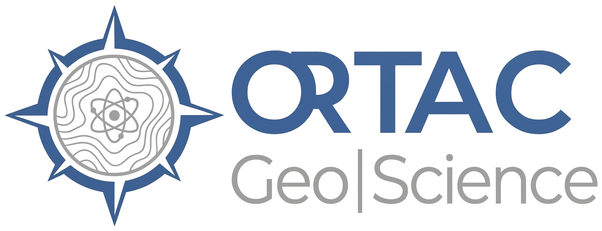
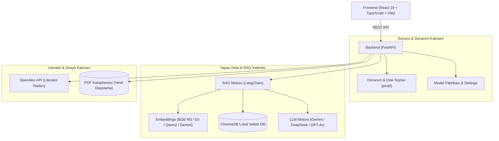

# 🌐 ORTAC Geo|Science — Akademik Asistan (Academic Assistant AI)

<p align="center">
  
</p>

<p align="center">
  <strong>Yapay Zekâ Destekli Akademik Araştırma, Literatür Analizi ve Makale Taslak Üretim Motoru</strong>
</p>

<p align="center">
  
  
  
  
  
  
  
</p>

---

## 📌 Proje Genel Bakışı

**ORTAC Geo|Science Akademik Asistan**, araştırmacıların, akademisyenlerin ve lisansüstü öğrencilerin literatür tarama, akademik makale inceleme, RAG (Retrieval-Augmented Generation) tabanlı sorgulama ve yayın taslağı oluşturma süreçlerini uçtan uca hızlandıran kurumsal düzeyde bir yapay zekâ masaüstü platformudur.

Tamamen **çevrimdışı ve yerel veri gizliliği** prensibiyle çalışan yerel vektör veritabanı (ChromaDB) ve dinamik donanım analizi sayesinde, makaleleriniz hiçbir üçüncü taraf sunucuya aktarılmadan güvenle indekslenir.

---

## ✨ Temel Özellikler

### 1. 🛡️ Profesyonel Kurulum Sihirbazı & Donanım Teşhisi (Onboarding Wizard)
- **Dinamik Donanım Analizi:** Sistemdeki toplam/boş bellek (RAM) ve işlemci çekirdeklerini otomatik tespit eder.
- **Model Seçimi:**
  - `multilingual-e5-small`: 512 sözcük, 500 MB RAM tüketimi, ultra hızlı.
  - `BAAI/bge-m3` *(Önerilen)*: 8.192 sözcük, anlamsal + terimsel (BM25) hibrit arama.
  - `gte-Qwen2-7B-instruct`: 32.768 sözcük devasa bağlam penceresi, derin kavrayış.
  - `cloud-gemini`: Sıfır donanım yükü, bulut embedding alternatifi.
- **Disk Güvenlik Kilidi:** İhtiyaç duyulan boş alan `Model Boyutu + 20 GB Kütüphane Payı` olarak hesaplanır. Yetersiz sürücülerde kurulum butonu kilitlenerek veri kaybı önlenir.

### 2. 📚 Akıllı Belge Yöneticisi & RAG Motoru
- **PDF İşleme:** PyMuPDF ile yüksek hızlı metin ve tablo çıkarma.
- **Otomatik Künye Çıkarımı:** Başlık, yazarlar, yayın yılı ve anahtar kelimeleri otomatik etiketleme.
- **Hibrit Arama:** Vektör benzerliği ve anahtar kelime eşleştirmesi ile formül, tablo ve isimleri kaçırmayan arama.

### 3. 📡 Açık Erişim Literatür Radarı (OpenAlex Entegrasyonu)
- Milyonlarca uluslararası akademik makale arasında anlık tarama.
- Açık erişimli (Open Access) PDF yayınlarını tek tıkla doğrudan yerel kütüphaneye indirme ve indeksleme.
- DOI bağlantısı ve gelişmiş filtreleme seçenekleri.

### 4. ✍️ OpenDraft Makale Taslak Motoru
- A4 formatında bağımsız zengin metin (WYSIWYG) editörü.
- RAG kütüphanenizdeki makalelerden doğrudan atıf ve referans çekerek akademik standartlarda taslak üretimi.
- Word (`.docx`) formatında dışa aktarma desteği.

### 5. 🤖 Çoklu Yapay Zekâ Sağlayıcı Yönetimi
- Google Gemini (Flash / Pro), DeepSeek, OpenAI (GPT-4o), Anthropic Claude, Perplexity ve NVIDIA NIM modellerini görev bazlı dinamik atayabilme.

---

## 🏛️ Mimari Şema



---

## 💻 Teknoloji Yığını

| Katman | Teknoloji | Açıklama |
|---|---|---|
| **Arayüz (Frontend)** | React 19, TypeScript, Vite 8 | Yüksek performanslı SPA arayüzü |
| **Tasarım Dili** | Linear & Raycast Obsidian Koyu Tema | `#09090b` zemin, modern mikro-animasyonlar |
| **Metin Editörü** | Jodit Editor | A4 uyumlu akademik taslak editörü |
| **Sunucu (Backend)** | Python 3.11+, FastAPI, Uvicorn | Asenkron yüksek hızlı REST API |
| **RAG & Vektör** | ChromaDB, LangChain, SentenceTransformers | %100 yerel vektör veritabanı |
| **Embedding Modelleri** | BAAI/bge-m3, multilingual-e5-small | Hibrit ve çok dilli anlamsal temsil |
| **Açık Erişim API** | OpenAlex REST API | Küresel literatür tarama motoru |
| **Donanım Teşhisi** | psutil | RAM, CPU çekirdek ve disk alanı analizi |

---

## 🚀 Hızlı Başlangıç

### Gereksinimler
- **Python:** 3.11 veya üzeri
- **Node.js:** 18 veya üzeri
- **RAM:** Minimum 8 GB (16 GB ve üzeri önerilir)

### 1. Depoyu Klonlayın
```bash
git clone https://github.com/GuneyOrtac/ortac-academic-assistant.git
cd ortac-academic-assistant
```

### 2. Backend Kurulumu ve Başlatma
```powershell
cd dev/backend
python -m venv .venv
.\.venv\Scripts\Activate.ps1
pip install -r requirements.txt
python main.py
```
> Backend sunucusu `http://localhost:8000` adresinde çalışacaktır. API dokümantasyonu için `http://localhost:8000/docs` adresini ziyaret edebilirsiniz.

### 3. Frontend Kurulumu ve Başlatma
```powershell
cd dev/frontend
npm install
npm run dev
```
> Kullanıcı arayüzü `http://localhost:5173` adresinde açılacaktır.

---

## 📁 Dizin Yapısı

```
ortac-academic-assistant/
├── dev/
│   ├── backend/               # FastAPI Sunucusu & Python Servisleri
│   │   ├── main.py            # Ana REST API Yönlendirici
│   │   ├── rag.py             # RAG & Dinamik Vektörleme Motoru
│   │   ├── model_factory.py   # Embedding Profilleri & LLM Yöneticisi
│   │   ├── library_manager.py # Dinamik Kütüphane Yöneticisi
│   │   ├── chat_engine.py     # Sohbet & Atıf Motoru
│   │   ├── requirements.txt   # Python Bağımlılıkları
│   │   └── veri/              # Kütüphane & Ayarlar (Gitignore ile korunur)
│   └── frontend/              # Vite + React 19 Kullanıcı Arayüzü
│       ├── src/
│       │   ├── App.tsx        # Ana Uygulama & Panel
│       │   ├── SetupWizard.tsx# 4 Kademeli Kurulum Sihirbazı
│       │   └── SettingsTab.tsx# Model & API Ayarları
│       └── package.json       # Node.js Bağımlılıkları
├── Logo/                      # Kurumsal Logolar ve İkon Setleri
├── memory-bank/               # Proje Mimarisi ve İlerleme Hafızası
├── .gitignore                 # Güvenlik ve Hariç Tutma Kuralları
├── start.ps1                  # Tek Tıkla Başlatma Scripti
└── README.md                  # Proje Tanıtım ve Dokümantasyonu
```

---

## 🔒 Güvenlik ve Gizlilik

- **Sıfır Veri Sızıntısı:** İndekslenen PDF'ler ve oluşturulan ChromaDB vektörleri tamamen kullanıcının yerel diskinde saklanır.
- **Hassas Bilgiler:** API anahtarları `.env` ve `settings.json` dosyalarında yerel olarak korunur; `.gitignore` ile GitHub'a gönderilmesi engellenmiştir.

---

## 👨‍💻 Geliştirici ve Telif Hakkı

- **Geliştirici:** Dr. Güney ORTAÇ
- **Kurum:** ORTAC Geo|Science
- **Lisans:** Özel Mülkiyet (Tüm Hakları Saklıdır © 2026)
